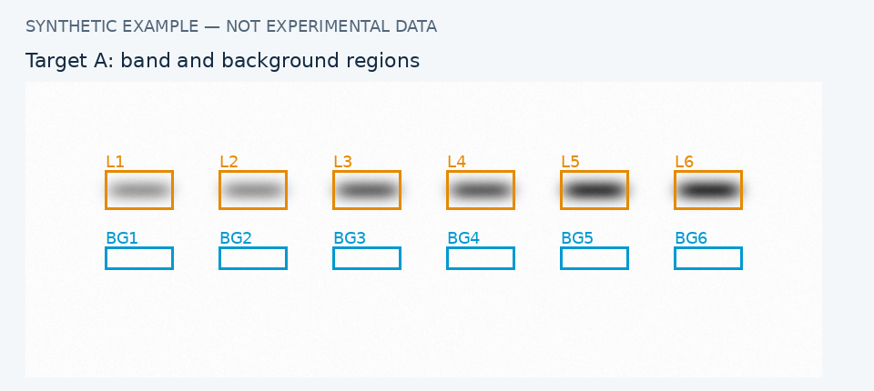
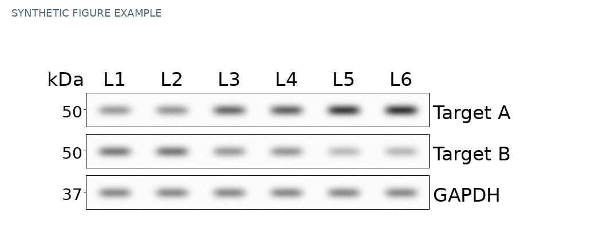
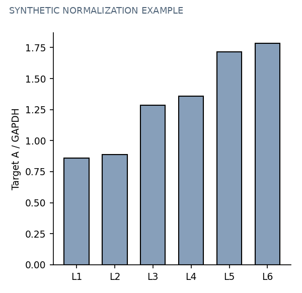

# Western Blot Image Processor & Analyzer

A Python/Streamlit tool for Western blot quantification, loading-control normalization, cropping and figure annotation.

## 1. Features and usage

- TIFF/PNG/JPEG input; native 16-bit grayscale pages preferred when available.
- Editable band and local background regions, with copy/paste, delete and undo.
- Lane-matched normalization, CSV/Excel tables, and per-lane or mean ± SD charts.
- Fixed-size figure strips, formatted labels, and 300/600 DPI TIFF/PDF export.
- Editable project ZIPs retaining original files and processing history.

### Start locally

Python 3.12 is the tested environment. In the directory containing `app.py`:

```bash
python3 -m pip install -r requirements.txt
python3 -m streamlit run app.py
```

Open the URL printed in the terminal, usually `http://localhost:8501`. Try **Load synthetic demo** first.

### Analyze an experiment

1. **Upload images**, or restore a project ZIP. Prefer original lossless TIFF; JPEG cannot recover acquisition intensities.
2. **Samples:** enter lane count and labels. Figure group headings and statistical conditions are separate. Edit condition/replicate defaults to match the experiment.
3. **Add / manage proteins:** name each protein, select its image and verify membrane IDs. One entry produces one figure strip.
4. **Images and cropping:** choose the displayed band polarity; draw/review a crop and click **Confirm crop**. The first confirmed crop defines all figure-strip dimensions. Figure crops and measurement regions are separate.
5. **Quantification and normalization:** select control and targets; **Auto-select regions** for each protein. Review every band. Resizing lane 1's band synchronizes other existing band sizes; all lanes remain independently resizable afterward. Moving lane 1 alone preserves custom sizes.
6. Enable **Show background regions**: orange = band, blue = background used in calculation. Choose **Background (blue)** under **Edit region**, or click a blue box, to move/resize/redraw it. Manual backgrounds stay fixed when bands move. Hiding affects display only. **Reset this lane to automatic background** restores automatic selection. Re-running auto-selection replaces all regions for that protein.
7. Click **Calculate intensities and normalization** after edits. Download results, prepare the figure under **Figure and export**, and save a project ZIP before closing.

For labels, choose the overall font **Regular** and use `*Pfkl*^{S775A/S775A}` for italic Pfkl with regular superscript. Also supported: `IL_{1}β`, `**bold**`, `***bold italic***`, and `\mathrm{regular}`.

## 2. Synthetic examples

**These are simulated data, not experimental evidence or validation of biological accuracy.** Synthetic 16-bit inputs are in [`examples/`](examples/).







Regenerate with `python3 examples/generate_readme_examples.py`.

## 3. Calculation methods

Measurements use native decoded pixels in floating-point arithmetic, not displayed or exported figure pixels. For native pixel `p` and configured sensor limits `L/U`, signal is `s = U - p` for native dark bands, or `s = p - L` for native light bands. Inverse TIFF display and inversion are mapped to the visual polarity choices.

```text
N                     = band-region width × height
Raw integrated signal = sum of s within the band region
Background value      = mean s within the selected background region
Net band intensity    = raw integrated signal - background value × N
Normalized ratio      = target net intensity / same-lane control net intensity
```

Projects retaining the median background setting use the median instead of the mean. Background and band areas need not match: the background estimates signal per pixel.

**Automatic background:** up to four nearby rectangles above/below the band are checked, using its horizontal span. The lowest-mean-signal candidate is selected. This is a suggestion; inspect it and use manual regions when inappropriate. The displayed and measured background selection is identical.

**Zeros and invalid values:** automatically undetected bands, manually marked absent bands and nonpositive net signals are assigned zero. Detailed exports retain the unassigned net measurement and reason. For a visible band missed automatically, edit its region or use **Measure current region manually**. Zero/invalid control intensity produces an unavailable ratio.

**Statistics:** average technical replicates within each biological replicate and condition, then calculate the biological-replicate mean and sample SD. No significance test is performed. Ratios are not additionally scaled to make a control condition equal to 1.

## 4. Common issues and precautions

| Issue | Action |
|---|---|
| Visible band reported as zero | Check polarity, region placement and detection status. Use manual measurement for an automatic miss. |
| Ratio unavailable | Check missing/overlapping regions, control intensity, membrane IDs, sensor limits and saturation exclusions. |
| Poor background estimate | Show blue regions and select representative, band-free areas. Recheck after polarity changes. |
| Results become stale | Recalculate after editing regions or parameters. |
| Multiple TIFF pages | Verify the selected signal page; a file may include a lower-bit-depth display page. |
| Compressed TIFF fails to load | Run `python3 -m pip install imagecodecs` in the same environment, then restart. |
| Labels are clipped | Adjust font size, margins or positions. kDa text does not create actual marker bands. |
| Session lost | Restore a downloaded project ZIP; sessions are not permanent storage. |

- Include the complete target band without adjacent bands. Use a consistent selection policy and representative backgrounds.
- Verify target/control sample pairing. User-entered membrane IDs do not prove correct pairing.
- Validate the linear detection range. No saturation flag does **not** establish linearity. A 16-bit file container does not prove a 16-bit acquisition range; use instrument/export information for sensor limits.
- Brightness, contrast and inversion change presentation, not quantitative pixels. Figure TIFFs are 8-bit RGB; original higher-bit-depth files remain in the project ZIP. DPI/interpolation do not add original detail.
- Disclose splices and assembled panels, retain originals and follow journal requirements. Passing software tests does not validate every experimental measurement.
- Hosted versions process uploads on the server; local runs process them on your computer. Processing history is not a tamper-proof signature or authenticity certification.
